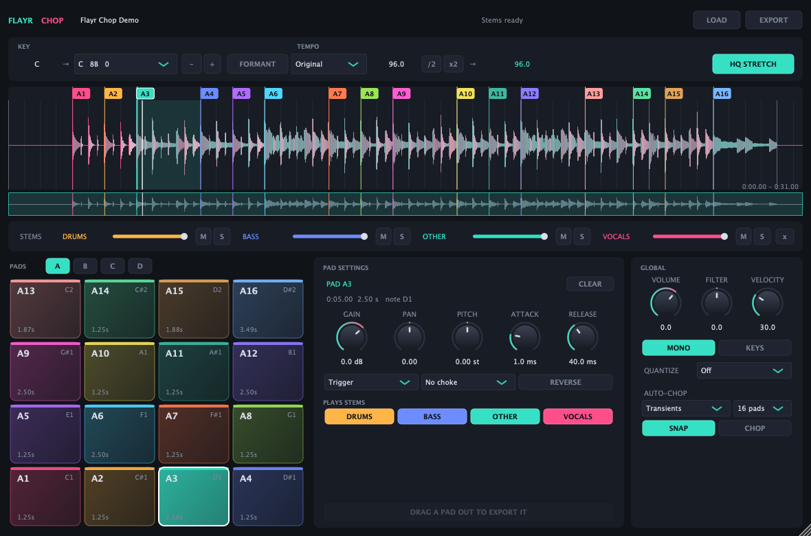

# Flayr Chop

Free, open-source sample chopper for your DAW. Drop in any track and Flayr Chop finds its tempo
and key, chops it onto pads, and lets you play it in any key at any tempo. It splits the track
into stems (vocals, drums, bass and more) on your own computer, and every pad can play just the
stems you want.

**AU and VST3 on macOS, VST3 on Windows, VST3 and LV2 on Linux.**



## What it does

- **Auto-chop.** Tempo, beat grid, key and transients are detected the moment a file loads
  (after separating stems, tempo and key are detected again from the drums and bass, which is
  more accurate). Uncertain detections are marked with a **?**; click the BPM or key for the
  ranked alternatives, or use **TAP** to tap the tempo in.
  Cues land on the strongest musical hits, or every beat, every 2 beats, every bar, or evenly.
  Drag any cue flag to move it (it snaps to the nearest transient), double-click to place one.
- **64 pads in 4 banks.** Each pad has its own level, pan, filter, attack, release, key shift and
  time stretch (both with HQ Stretch), Trigger / Gate / Loop mode, reverse and choke group.
  Pad A1 is C1 (MIDI note 36), like a drum rack.
- **Stems.** One click separates the track with Demucs v4, fully offline. Mix, mute and solo stems
  globally, and choose which stems each pad plays: an acapella on one pad and the drums of the
  same bar on the next.
- **HQ Stretch.** Change key and tempo independently with high-quality stretching. Pick a
  target key by name (with key-wheel codes like 8A) and Flayr Chop takes the shortest route there. Host
  Sync follows your session tempo and knows about half and double time, so a 90 BPM loop in a
  180 BPM session isn't stretched to twice its speed. **FORMANT** keeps vocals sounding natural
  when shifted. Switch HQ Stretch off for tape-style speed and pitch together.
- **Keys mode.** Play the selected pad across the keyboard (C3 = original pitch). Every note is
  rendered with HQ Stretch, so high notes don't get shorter and low notes don't drag.
- **Quantize** hits to the session grid (1/32 to 1 bar).
- **Drag any pad out** of the plug-in to drop its slice into your DAW or Finder, at the current
  key and tempo. **EXPORT** writes the whole track, its stems, or a bank of slices.
- DJ-style filter, velocity sensitivity, mono or polyphonic playback.

## Install

Grab the latest version from **[Releases](https://github.com/FlayrLabs/flayr-chop/releases/latest)**.

| Your computer | Download | Formats |
|---|---|---|
| Mac (Apple silicon or Intel, macOS 11+) | `FlayrChop-<version>-macOS.dmg` | AU + VST3 |
| Windows 10/11 (64-bit) | `FlayrChop-<version>-Windows-Setup.exe` | VST3 |
| Linux (x64) | `FlayrChop-<version>-Linux-x64.tar.gz` | VST3 + LV2 |

### Mac
1. Open the DMG.
2. Drag **Flayr Chop.component** onto **Drag AU here** and **Flayr Chop.vst3** onto **Drag VST3 here**.
3. Restart your DAW. Flayr Chop is an instrument: load it on a software instrument / MIDI track.

### Windows
Run the installer. It puts the plug-in in `C:\Program Files\Common Files\VST3`.

### Linux
```sh
tar xzf FlayrChop-*-Linux-x64.tar.gz
cd FlayrChop-*-Linux-x64 && ./install.sh     # installs to ~/.vst3 and ~/.lv2
```

### The stem model

The first time you press **SEPARATE STEMS**, Flayr Chop downloads the Demucs model (84 MB, once)
and checks it against a pinned SHA-256. After that everything runs offline. On Linux, or to
install it ahead of time, run `scripts/fetch-model.sh`. Stems are cached per file, so reopening a
project doesn't separate again.

## Using it

1. Drag a track onto the plug-in (or press **LOAD**). WAV, AIFF, FLAC, MP3 and M4A all work, from
   Finder or from your DAW's browser.
2. **Chop it live:** press **PLAY** (or space) and hit an empty pad (click it, press its computer
   key, or play its MIDI note) where you want a cue. Late taps snap back to the hit you meant
   (turn off **SNAP** for exact placement). Or let **AUTO-CHOP** do it: Find samples, every
   beat/bar, Slicer from playhead, Random, or Key shift pad (one pad across the bank in key).
3. **Edit cues on the waveform:** drag a cue's flag or line to move it, drag on empty waveform to
   pull out a new cue, drag the tab at the bottom of a selected slice to set where it ends, and
   nudge with **<** **>** or the arrow keys (shift: a 16th note). Click to move the playhead.
4. **Pads:** pads with a cue play it; their computer keys are shown on each pad (A W S E D F T G
   on the bottom rows, Y H U J K O L ; above). Shift-click to select several and every knob
   changes them all. Drag a pad onto another to move it, Option-drag to copy. **SELECT ALL**,
   **DELETE** (or backspace) and **CLEAR ALL** work on cues; favorites survive auto-chop.
5. Set the **KEY** and **TEMPO** you want. If a detection is off (marked **?** when unsure),
   click the BPM or key for alternatives, use **/2**, **x2** or **TAP**, or type the tempo in.
6. **Drag pads out** of the plug-in into your DAW (several at once when selected). Slices are
   saved in `Music/Flayr Chop/Slices`, so your project keeps finding them.

The plug-in takes your computer keyboard while you're working in it; click your DAW to give it
back.

Projects remember the file path, cues, pad settings and detected tempo and key. Every sample you
load also gets a copy in `Music/Flayr Chop/Samples` (a clone that takes no extra space where the
disk supports it, and one copy per sound however often you use it), so projects reopen even in
hosts that only let plug-ins read a few folders, such as Logic. If both the file and its copy are
gone, drop the file on the plug-in again to relink. Samples on network shares are never opened
automatically when a project loads; drop them on the plug-in to relink.

**Where Flayr Chop keeps files, and how to clear them.** On every platform the copies in
`Music/Flayr Chop/Samples` stay until you delete them, and on Windows and Linux (no clones) each one
takes the full size of the sample. Projects store the copy's path, whose name is a SHA-256 checksum
of the audio. Delete the folder whenever you like: projects whose original files are still in
place just make a new copy the next time they load. Separated stems are cached per sample (macOS
`~/Library/Application Support/Flayr Chop/stems`, Windows `%APPDATA%\Flayr Chop\stems`, Linux
`~/.config/Flayr Chop/stems`) and can be deleted the same way: stems are separated again when needed.
The stem model is in `Flayr Chop/models` (macOS `~/Library/Application Support`, Windows `%APPDATA%`,
Linux `~/.local/share` or `$XDG_DATA_HOME`).

## Building from source

Needs CMake 3.24+ and a C++17 compiler. JUCE, Signalsmith Stretch and Eigen are downloaded at
configure time.

```sh
cmake -S . -B build -DCMAKE_BUILD_TYPE=Release
cmake --build build --parallel
ctest --test-dir build --output-on-failure
```

The plug-ins are copied into your user plug-in folders after building
(`-DFLAYR_CHOP_COPY_AFTER_BUILD=OFF` to skip). `-DFLAYR_CHOP_BUILD_TOOLS=ON` adds
`FlayrChopSnapshot`, which loads a track without a DAW, renders the UI to a PNG and plays every
pad into a WAV.

## License

GNU AGPLv3 (see [LICENSE](LICENSE)), because JUCE is used under its AGPLv3 option. Third-party
components and their licenses are listed in [THIRD_PARTY_NOTICES.md](THIRD_PARTY_NOTICES.md).
